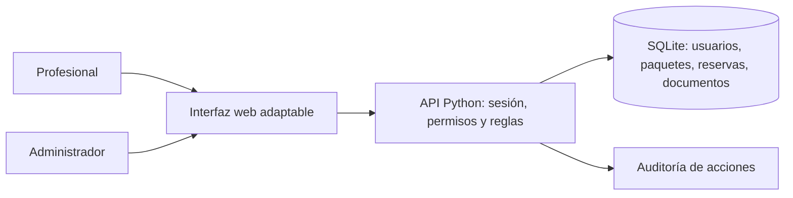

# Valhalla Office — prototipo de reservas

Aplicación funcional para desarrollar y validar el flujo de un centro con **tres boxes profesionales**. No procesa dinero, no se ha publicado y no se conecta a proveedores externos. Está separada de la página de bingo de AVOJA, que permanece intacta.

## Requerimientos y decisiones

| Necesidad | Comportamiento implementado |
| --- | --- |
| Registro profesional | Nombre, correo único, especialidad y contraseña de al menos 10 caracteres. |
| Verificación | Carga privada de PDF ficticio, revisión manual, aprobación o rechazo con motivo. Solo el último documento define la verificación. Una nueva carga vuelve la cuenta a revisión. |
| Disponibilidad | Tres boxes, todos los días de 08:00 a 20:00, zona `America/Santiago`, consulta de hoy a 90 días. |
| Paquetes | 5, 10 y 20 horas. Un saldo por paquete usable en cualquiera de los boxes. Precios de ejemplo: $45.000, $85.000 y $160.000 CLP. Sin vencimiento en este prototipo. |
| Propiedad | El servidor toma el titular de la sesión; nunca de un identificador enviado por el cliente. No existe una operación de transferencia. |
| Reserva | Una hora exacta, profesional activo/verificado, pago confirmado y saldo disponible. Consume primero el paquete confirmado más antiguo con saldo. |
| Duplicados | Un box no admite dos reservas en el mismo horario. Un profesional tampoco puede reservar dos boxes simultáneamente. |
| Modificación | Máximo una por reserva; al menos 2 horas antes de la reserva vigente y del nuevo horario. Cambiar box, fecha o ambos consume ese cambio. Un intento fallido o sin cambios no lo consume. |
| Pagos | Solicitud pendiente; el administrador confirma o rechaza una **simulación**. No hay tarjetas, pasarelas ni cobros. |
| Administración | Documentos, pagos, usuarios, reservas y registro de acciones. Desactivar cierra sesiones y conserva reservas existentes. |
| Cancelación | Decisión provisional: solo administración cancela reservas futuras y devuelve 1 hora al paquete original, una sola vez. |
| Interfaz | Panel profesional y administrativo, navegación móvil, diálogos de confirmación y mensajes de error. |

Horarios, duración y tamaños de paquetes fueron confirmados por el usuario. Precios, vigencia, requisitos documentales, feriados, política de cancelación y requisitos legales siguen siendo decisiones de producto para producción. La verificación de este prototipo es una revisión manual; no comprueba identidad ni autenticidad documental ante una entidad oficial.

## Arquitectura

La interfaz HTML/CSS/JavaScript consume una API JSON del mismo origen. La API autentica, autoriza y aplica las reglas antes de escribir en SQLite. Los archivos PDF se guardan en la base de datos y se entregan solo como descargas privadas al titular o administrador. La aplicación no depende de CDNs ni paquetes descargados.



Entidades: `users`, `sessions`, `documents`, `packages`, `bookings` y `audit`. Cada reserva apunta al titular y al paquete que consumió. El estado del pago controla si su saldo es utilizable. Las transacciones `BEGIN IMMEDIATE` serializan los cambios de saldo y agenda; un índice único parcial sobre `(box, start)` protege las reservas confirmadas. Un trigger impide cambiar el propietario de un paquete incluso mediante una actualización directa de la tabla. Los horarios se normalizan a UTC y se muestran en Chile, incluyendo sus cambios de horario.

Las contraseñas usan PBKDF2 con sal individual. Las sesiones tienen vencimiento de 8 horas, cookie HttpOnly/SameSite y token CSRF para operaciones autenticadas. Las rutas administrativas y la descarga documental verifican permisos en el servidor. No se incluyen contraseñas ni contenido de PDFs en las respuestas de los paneles.

**Arquitectura recomendada para producción:** mantener el mismo dominio de negocio con una API de aplicación (por ejemplo FastAPI), PostgreSQL y restricciones de exclusión de intervalos si se admiten duraciones variables; almacenamiento privado de documentos con descargas firmadas; proveedor de identidad o autenticación endurecida; cola para notificaciones y webhooks de pago idempotentes. El saldo debe evolucionar a un libro de movimientos auditable. Incorporar migraciones, monitoreo, copias y restauración, HTTPS, cookies Secure, límites de intentos, recuperación de contraseña, validación de correo, MFA administrativo y análisis de archivos. Cualquier integración de cobros o publicación requiere autorización expresa.

## Ejecutar

### Vista previa dentro de ChatGPT

Abre `vista-previa.html` en el panel de vista previa. Es un archivo autónomo con CSS y JavaScript integrados: no requiere servidor ni acceso a `/api`. Inicia directamente en el panel profesional de demostración. Para explorar administración, cierra sesión y pulsa Acceso administrador. Las reservas, paquetes, documentos y pagos de esta vista son simulaciones en memoria; los datos se reinician al recargar y no se comparten con la base SQLite ni con otros navegadores. Usa exclusivamente documentos ficticios.

La versión completa con autenticación y reglas de servidor sigue en `app.py`. Para regenerar la vista después de cambios en la interfaz: `python3 build_preview.py`. `preview-api.js` contiene únicamente el adaptador de demostración; no sustituye la seguridad ni las transacciones del servidor.

### Aplicación completa con servidor

Requisitos: Python **3.10 o superior** y base de zonas horarias del sistema (incluida en este entorno). Sin instalación de dependencias.

```bash
cd /workspace/AVOJA/valhalla
python3 app.py --seed-demo
```

En un equipo local abre `http://127.0.0.1:8080` en el navegador. En el entorno cloud usa las herramientas internas de navegador; no se ha publicado un enlace de acceso público. `Ctrl+C` detiene el servidor. Para otro puerto usa `--port 8081`. Escucha en loopback por defecto; `--host 0.0.0.0` solo si tu entorno de desarrollo necesita acceder al proceso desde otra interfaz.

Se crea `data/valhalla.sqlite3` (ignorado por Git), con persistencia entre reinicios. `--seed-demo` es repetible: crea solo las cuentas y el paquete inicial que no existen; no repone horas consumidas ni reemplaza contraseñas. Puedes usar una base nueva para una demo limpia, sin eliminar tus datos:

```bash
python3 app.py --seed-demo --db /tmp/valhalla-demo-nueva.sqlite3 --port 8081
```

| Rol | Correo ficticio | Contraseña de demostración |
| --- | --- | --- |
| Profesional verificado con 10 h iniciales | `profesional@valhalla.demo` | `ValhallaDemo2026!` |
| Administrador | `admin@valhalla.demo` | `ValhallaAdmin2026!` |

Los botones de acceso demo usan estas cuentas. Las credenciales son públicas y exclusivas de pruebas; no uses esta base ni estas cuentas para producción. Una ejecución sin `--seed-demo` permite registro profesional pero no crea un administrador: para explorar el flujo completo utiliza la base demo.

## Probar

Pruebas automáticas (bases temporales independientes de tus datos):

```bash
cd /workspace/AVOJA/valhalla
python3 -m unittest discover -s tests -v
```

Prueba opcional en navegador, que crea datos ficticios: inicia otra instancia con una **base descartable**, por ejemplo `python3 app.py --seed-demo --db /tmp/valhalla-prueba-ui.sqlite3 --port 8081`, y en otra terminal ejecuta `node tests/browser.cjs`. Requiere Node, Playwright y Chromium (ya disponibles en este entorno; no son dependencias del servidor). Puedes cambiar la URL con `VALHALLA_TEST_URL` y la ruta de Chromium con `CHROMIUM_PATH`. Fuera de este entorno, instala Playwright en una carpeta temporal y expón su `node_modules` mediante `NODE_PATH`; el navegador debe estar instalado. Esta prueba recorre registro, documentos, pagos simulados, reserva, modificación, cancelación, devolución, desactivación y móvil. No la ejecutes contra datos reales.

Recorrido manual:

1. Entra como profesional demo. Ve a Disponibilidad, elige mañana y confirma una hora. En Mis reservas debe aparecer y el saldo baja de 10 a 9.
2. Modifica la reserva a otra hora futura con más de dos horas de anticipación. No se descuenta otra hora y el botón de modificación desaparece. El servidor también rechaza un segundo cambio.
3. Solicita un paquete. Queda pendiente y no suma saldo disponible. Cierra sesión y entra como administrador; confirma el pago **simulado**. Al volver como profesional se habilita el saldo.
4. Registra un nuevo profesional con otro correo. Puede ver disponibilidad pero no reservar. Adjunta un PDF ficticio; como administrador descarga el archivo, revísalo y apruébalo. Confirma también su paquete simulado para habilitar reservas.
5. Con otro profesional verificado, intenta el mismo box y hora. Aparecerá ocupado; solicitudes simultáneas por API dejan solo una reserva confirmada. Reservar otro box a la misma hora con el mismo profesional también se rechaza.
6. En Administración → Reservas cancela una reserva futura. Se devuelve su hora y se libera el box. Una segunda cancelación se rechaza.
7. En Administración → Usuarios desactiva una cuenta profesional. Sus sesiones dejan de funcionar y no puede iniciar sesión hasta reactivarse.
8. Reduce la ventana a 390 px: la navegación queda arriba y los contenidos se adaptan. Las tablas administrativas pueden desplazarse horizontalmente.

Para crear un PDF ficticio de prueba válido sin datos personales:

```bash
python3 - <<'PY'
from pathlib import Path
objects = [
 b'<< /Type /Catalog /Pages 2 0 R >>',
 b'<< /Type /Pages /Kids [3 0 R] /Count 1 >>',
 b'<< /Type /Page /Parent 2 0 R /MediaBox [0 0 300 150] /Resources << /Font << /F1 4 0 R >> >> /Contents 5 0 R >>',
 b'<< /Type /Font /Subtype /Type1 /BaseFont /Helvetica >>',
]
stream = b'BT /F1 12 Tf 20 75 Td (Documento FICTICIO - Solo pruebas) Tj ET'
objects.append(b'<< /Length ' + str(len(stream)).encode() + b' >>\nstream\n' + stream + b'\nendstream')
pdf = b'%PDF-1.4\n'
offsets = [0]
for i, obj in enumerate(objects, 1):
    offsets.append(len(pdf))
    pdf += str(i).encode() + b' 0 obj\n' + obj + b'\nendobj\n'
xref = len(pdf)
pdf += b'xref\n0 6\n0000000000 65535 f \n'
pdf += b''.join(f'{offset:010d} 00000 n \n'.encode() for offset in offsets[1:])
pdf += b'trailer\n<< /Size 6 /Root 1 0 R >>\nstartxref\n' + str(xref).encode() + b'\n%%EOF\n'
Path('/tmp/acreditacion-ficticia.pdf').write_bytes(pdf)
PY
```

## Alcance y límites

Este servidor HTTP y SQLite son apropiados para un prototipo local de un solo servicio. No están preparados para exponer documentos reales ni operar reservas comerciales. No hay notificaciones, recuperación de cuenta, expiración de paquetes, agenda por profesional externo ni conciliación bancaria. La carga comprueba extensión, tamaño y firma PDF; no sustituye validación completa ni análisis antimalware. Las cuentas demo verificadas son una excepción explícita para recorrer la interfaz sin cargar documentos. Las pruebas automáticas cubren reglas, concurrencia y permisos; pantalla completa, pagos reales y despliegue no forman parte de este prototipo.

## Publicar una demo de prueba en Render

La publicación de una demo ficticia, sin cobros reales, fue autorizada. Se preparó `../render.yaml` para un servicio web Docker. **Aún no se ha desplegado ni existe un enlace público verificado.** La publicación en Render se completa desde la cuenta de alojamiento del usuario. La API GitHub y el acceso Git por HTTPS son capacidades distintas; esta entrega usa Git para subir la rama `valhalla-demo`.

1. Crea una cuenta en `https://render.com` y conecta GitHub desde la interfaz del proveedor. No compartas contraseñas ni tokens por chat.
2. Conecta la rama `valhalla-demo`, que contiene `valhalla/` y `render.yaml`. Conserva `valhalla/data/` fuera del repositorio; contiene los datos locales y no se copia a la imagen Docker.
3. Crea un **Blueprint** desde `santibanezfcarlos-art/AVOJA` y la rama que contenga los archivos. Revisa el servicio `valhalla-office-demo` y las condiciones actuales del plan gratuito antes de crearlo. También puedes crear un Web Service Docker con directorio raíz `valhalla` y archivo `Dockerfile`.
4. Render termina HTTPS y suministra `PORT`. El contenedor inicia las cuentas demo con cookies Secure y una base nueva. Usa solo nombres, correos y documentos ficticios: el administrador de demostración es compartido y puede ver todos los datos de la demo.
5. Tras un despliegue correcto, copia la URL HTTPS que Render asigne. Verifica el título, el inicio de sesión profesional y administrador, y una reserva de prueba antes de compartirla.

El disco del plan gratuito es efímero: los datos pueden perderse al reiniciar o desplegar, y el servicio puede suspenderse por inactividad. No cambies al plan de pago ni adjuntes un medio de pago sin decidirlo expresamente. Antes de una operación comercial se necesita la arquitectura de producción descrita arriba; esta configuración publica únicamente una demo compartida.

Para construir y comprobar la imagen localmente:

```bash
cd /workspace/AVOJA/valhalla
docker build -t valhalla-office:demo .
# Para probar con HTTP local se reemplaza el comando HTTPS del contenedor:
docker run --rm -p 127.0.0.1:8082:8080 valhalla-office:demo \
  python app.py --host 0.0.0.0 --port 8080 --seed-demo
```
